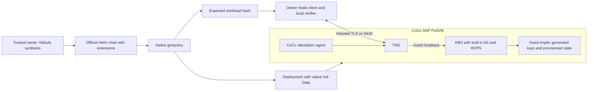

# Trustee on CoCo with native Helm and genpolicy

`Trustee` is a `BaseConstruct<TrusteeConfig>` that renders the official Trustee
Helm chart, runs native Kata `genpolicy` on that exact Deployment, and attaches
the generated CoCo Init-Data annotation. It exposes the generated `identity`
directly to `@nebula/trustee-client`. There is no separate workload artifact,
manual policy binding, bootstrap KBS, or Trustee fork. `TngTrustee` is an alias.

The [official Trustee chart](https://github.com/confidential-containers/trustee/tree/3e160008ef3e5d8ce82e59c729d56e2d0175dba0/deployment/helm-chart)
is an external Helm dependency. Like other Nebula modules, `Trustee` passes the
chart reference, repository and version directly to cdk8s `Helm`. Helm resolves
the dependency. The construct has no custom downloader and does not check out Git
or build chart dependencies. No upstream chart files, templates, scenarios or
subchart archives ship in Nebula.

`chart` is required: supply a Helm chart reference, OCI URL, packaged chart or
prepared local directory. `repository` supplies the Helm repository URL for a
named chart; omit it for OCI and local charts. `version` defaults to the qualified
chart version, `0.21.0`. Upstream currently distributes Git source and is still
[discussing chart publication](https://github.com/confidential-containers/trustee/issues/1597),
so the module does not invent a default repository.

CI records the upstream commit, chart version and upstream `Chart.lock` checksum
in [the Helm pins](../../../../../../.github/trustee-chart.json). The reusable
[chart build workflow](../../../../../../.github/workflows/build-trustee-chart.yml)
keys its saved package only by those pins, independently of Nebula code or commit
IDs. It restores an exact existing package first. Only changed Helm pins allow a
new build: check out upstream, verify `Chart.lock`, resolve the locked dependencies,
then package and lint with standard Helm commands. Formatting the pins file does
not change the package key.

The separate [Trustee validation workflow](../../../../../../.github/workflows/verify-trustee.yml)
runs on module, shared code, test and build-input changes. It reuses the existing
chart package and runs native genpolicy against the current module. Workload
policy is generated during each validation; it is never cached with the chart.
The [publication workflow](../../../../../../.github/workflows/publish-trustee-chart.yml)
publishes that same package with `helm push` to OCI when Helm pins change or on
explicit dispatch. Consumers pin the OCI manifest digest. Publication does not
rebuild the archive, and module changes only rerun validation.
Both jobs verify the package checksum. Documentation-only PRs and unrelated
modules do not trigger validation. General checks stay in `verify-modules.yml`.

The chart package uses GitHub Actions' exact-key, branch-scoped cache without
fallback keys. PR caches cannot replace the main-branch package. If GitHub evicts
the package, validation with unchanged pins fails instead of rebuilding. A
maintainer can explicitly run **Build Trustee Helm chart** with `repair-cache`
on the relevant ref (or `main` for shared pins), then rerun validation. Both
optional database subcharts remain disabled.

Only KBS Deployment and Service templates are selected with Helm's `--show-only`.
The [TypeScript extensions](helm.ts) patch those resources to run one SNP PodVM
with built-in AS/RVPS and a TNG sidecar: remove the external-AS init container,
replace Kubernetes config/key mounts with guest tmpfs, pin the KBS image and
measured startup, enforce read-only storage, and route the Service to attested TLS.
Separate AS/RVPS workloads, bootstrap Jobs, Secrets, ConfigMaps and key-management
RBAC never enter the synthesized manifests. The unmodified chart's default
topology and key custody do not provide this isolation; native genpolicy measures
the final extended Deployment before it can be synthesized.



## Use

Install Helm and the pinned native [genpolicy tool](../../../../../../tools/genpolicy/README.md)
on the trusted synthesis machine. Rust is needed only to build that tool.
Use an owner-approved copy of the official chart. For an upstream Git checkout,
prepare it once using the normal upstream Helm dependency workflow:

```sh
git clone https://github.com/confidential-containers/trustee.git trustee-upstream
git -C trustee-upstream checkout 3e160008ef3e5d8ce82e59c729d56e2d0175dba0
helm dependency build ./trustee-upstream/deployment/helm-chart --skip-refresh
```

Set `chart` to `./trustee-upstream/deployment/helm-chart`, or use a package made
with `helm package`. A published copy of the unmodified chart can instead be
selected with `chart: "trustee"`, `repository: approvedChartRepository` and
`version: "0.21.0"`, or with `chart: approvedOciChartUrl` and the same version.
Chart preparation belongs to the dependency publisher or consuming application's
build, and never runs inside the construct. It does not introduce a workload
artifact or manual policy step: native genpolicy still runs during synthesis.

Synthesis needs registry access for the two pinned images and, for a remote
chart, access to its Helm repository. The optional genpolicy cache avoids repeated
image downloads. Importing Nebula remains free of file reads or subprocesses.

```ts
import { App, Chart } from "cdk8s";
import { Trustee } from "nebula-cdk8s";
import { prepareClient } from "@nebula/trustee-client";

const app = new App();
const chart = new Chart(app, "keys");
const trustee = new Trustee(chart, "trustee", {
  name: "trustee",
  namespace: "confidential-keys",
  chart: "./trustee-upstream/deployment/helm-chart",
  kbsImage: approvedKbsDigest,
  tngImage: approvedTngDigest,
  ownerPublicKeyPem,
  nodeSelector: { "workload.example.test/snp": "true" },
  clients: [{ namespace: "workloads", podLabels: { app: "recipient" } }],
  network: {
    ipv4AddressPattern: "^192[.]0[.]2[.][0-9]{1,3}$",
    ipv6AddressPattern: "^2001:db8:[0-9a-f:]+$",
  },
  guest: approvedGuestIdentity, // measurement, chipId, minimumReportedTcb
  k8sDistribution: "k0s", // or "kubernetes"
  ociVersion: "1.3.0", // must match the runtime; also supports 1.1.0/1.2.0
});
app.synth();

// Owner-local verification state, created once in a fresh private directory.
prepareClient({
  stateDirectory: "/private/new-trustee-client-state",
  identity: trustee.identity,
  target: { host: "trustee.example.test", port: 8443 },
});
```

The address patterns above are documentation values. Supply the cluster's
approved CNI ranges, public image digests and independently approved SNP guest
identity. The workload hash is generated automatically. Never learn expected
identity from the endpoint being verified. The `ownerPublicKeyPem` must be a
P-256 public key; keep its private key outside Kubernetes and infrastructure
administrators' control. All construct inputs are public literals; `ref+`
resolution is rejected before `BaseConstruct` can access the synthesis host.

The construct exposes `helm`, `deployment`, `service`, `networkPolicy`, optional
`namespace`, `serviceUrl`, `identity`, and `initDataSha256`. Namespace creation
is enabled by default. `genpolicy.executable` selects an installed binary and
`genpolicy.cacheDirectory` selects a trusted owner-local cache. Tool failures,
unexpected chart topology or incompatible native output abort construction.
There is no caller-supplied policy or generic Helm-values escape hatch.

See [the example](../../../../example/trustee.ts) for JSON configuration usage
and [the Node client](../../../../../trustee-client/README.md) for owner JWT
administration, attestation policy, resource policy and provisioning APIs.
Workload retrieval continues to use the native CoCo KBS protocol. Owner JWTs
authorize administration; recipient attestation authorizes secret release.

## Administrator isolation

SNP attestation authenticates the approved guest measurement and Init-Data
hash. The guest validates Init-Data against SNP HOST_DATA and loads the native
agent policy. That policy binds the pulled image digests, exact startup
arguments, owner public key, application configuration, privileges and guest
memory storage. TNG uses CoCo AA evidence to bind its TLS public key to that
attestation; the owner client verifies the chain before provisioning.

The [versioned genpolicy profile](assets/genpolicy/README.md) closes host-agent
paths that upstream defaults leave available: exec and streams, replacement
policy, diagnostics, extra mounts, post-start network changes and container
recreation. Initial metadata copies and CNI configuration are narrowly bounded.
Native genpolicy produces the entire policy and Init-Data directly using its
rules/settings inputs. Nebula does not rewrite generated Rego or invent a
parallel workload measurement format. The pinned upstream InitData uses a Rust
HashMap, so its TOML field order is random. After validating native output,
Nebula serializes only the standard Init-Data envelope in fixed order and gzip
header format using a pinned JavaScript compressor, independent of the host's
Node/zlib version. The decoded `policy.rego` and `aa.toml` strings are preserved
byte-for-byte; the identity hashes the exact resulting TOML sent to the guest.
This makes independent owner and Argo syntheses agree without saving or accepting
an externally generated policy. Tests compare repeated native processes.

The multi-architecture `nebula-cmp` image includes this pinned, unmodified native
genpolicy alongside Helm. Argo needs registry access for the pinned images and
chart, but no owner private key or external Trustee. A changed approved input
changes the expected identity and requires owner verification again.

Only TNG listens on the Pod network. KBS and AA listen on guest loopback.
Signing keys are generated inside the guest; resources and policies start
with deny rules and remain in guest tmpfs. No Kubernetes Secret, projected
service-account credential, host filesystem or persistent disk stores them.
Kubernetes NetworkPolicy is additional filtering; guest enforcement and client
verification establish the boundary when Kubernetes or the host is hostile.
Use L4 pass-through. An infrastructure-controlled TLS terminator is incompatible
with this trust model. On the qualified dev runtime, Kubernetes port-forward
reaches the host-side network namespace; testing uses an SSH byte tunnel to
the actual Pod address and still verifies attestation independently.

## Qualification and limits

Native generation and Helm rendering are exercised together in
`trustee-module.test.ts`. `trustee-guest-policy.integration.ts` executes the
full rules profile using native Regorus, including hostile image, environment,
file-copy, network and agent requests. `trustee-policy.integration.ts` checks
SNP appraisal and per-resource recipient authorization with the pinned AS
policy/EAR engines. The Node package tests the real upstream KBS owner protocol.

The [sanitized dev SNP record](../../../../test/evidence/trustee-helm-genpolicy-snp-dev-2026-10-16.json)
records attested owner provisioning, wrong-identity/owner rejection, guest denial
of exec and changed images/commands, inaccessible guest-only ports, empty host
volumes and successful reprovisioning after replacement.

The [upstream-client requalification](../../../../test/evidence/trustee-tng-upstream-snp-dev-2026-10-19.json)
repeats attested owner operations, wrong-identity/owner rejection and administrator
exec denial with unmodified upstream TNG, using that same approved server manifest.

The [ArgoCD qualification](../../../../test/evidence/trustee-argocd-snp-dev-2026-10-19.json)
deploys through the existing DevOps app-of-apps and Nebula renderer. Independent
macOS and Linux amd64/arm64 synthesis produced byte-identical manifests and
expected identities. The live SNP workload matched the owner copy; two Argo hard
refreshes preserved its policy, Deployment generation and Pod UID without
container restarts. The actual Nebula CLI passed owner policy/resource operations
and wrong-owner/audience/VM/workload/chip rejection. Guest policy denied exec and
changed command/image canaries. The Argo-managed deployment remains running with
deny-all resource release; temporary test resources, canaries and tunnel were
removed. Resource retrieval by a second confidential workload was not tested.

This remains a prototype. State is deliberately ephemeral: PodVM replacement
loses resources and keys and requires owner verification and provisioning
again. Persistent creation latches prevent in-place container recreation.
Short-lived certificates have no renewal orchestration. The native client uses a
[pinned, unmodified upstream TNG revision](../../../../../../tools/tng-client/README.md)
containing merged PR #263; the deployed TNG and Trustee images are unchanged.

Attested TLS proves possession of the guest's TLS key; JWT authenticates the
owner. Identical approved instances are still allowed. This does not implement
singleton identity, durable state continuity, rollback prevention or continuous
freshness (`refresh_interval: 0`). Infrastructure can deny availability.
Independent source-to-image provenance and a production security review remain
outstanding. Earlier evidence records describe earlier prototypes and do not
qualify this Helm/native-genpolicy path.
