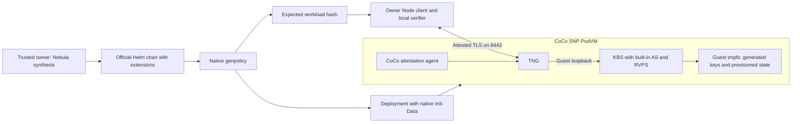

# Trustee on CoCo with native Helm and genpolicy

`Trustee` is a `BaseConstruct<TrusteeConfig>` that renders the official Trustee
Helm chart, runs native Kata `genpolicy` on that exact Deployment, and attaches
the generated CoCo Init-Data annotation. It exposes the generated `identity`
directly to `@nebula/trustee-client`. There is no separate workload artifact,
manual policy binding, bootstrap KBS, or Trustee fork. `TngTrustee` is an alias.

The bundled [official chart and extensions](assets/helm/README.md) support a
single SNP PodVM with KBS, its built-in AS/RVPS, and a TNG sidecar. Separate
AS/RVPS deployments, bootstrap Jobs, Kubernetes Secrets and chart ConfigMaps
are disabled. This mode requires the included extensions; the stock chart's
default topology and key custody do not provide administrator isolation.



## Use

Install Helm and the pinned native [genpolicy tool](../../../../../../tools/genpolicy/README.md)
on the trusted synthesis machine. Rust is needed only to build that tool, not
inside the module. Synthesis needs registry access to inspect the two pinned
images; an optional owner-local cache avoids repeat downloads. Importing Nebula
remains free of file reads or subprocesses.

```ts
import { App, Chart } from "cdk8s";
import { Trustee } from "nebula-cdk8s";
import { prepareClient } from "@nebula/trustee-client";

const app = new App();
const chart = new Chart(app, "keys");
const trustee = new Trustee(chart, "trustee", {
  name: "trustee",
  namespace: "confidential-keys",
  kbsImage: approvedKbsDigest,
  tngImage: approvedTngDigest,
  ownerPublicKeyPem,
  nodeSelector: { "workload.example.test/snp": "true" },
  clients: [{ namespace: "workloads", podLabels: { app: "recipient" } }],
  network: {
    ipv4AddressPattern: "^192[.]0[.]2[.][0-9]{1,3}$",
    ipv6AddressPattern: "^2001:db8:[0-9a-f:]+$",
  },
  guest: approvedGuestIdentity, // measurement, chipId, minimumReportedTcb
  k8sDistribution: "k0s", // or "kubernetes"
  ociVersion: "1.3.0", // must match the runtime; also supports 1.1.0/1.2.0
});
app.synth();

// Owner-local verification state, created once in a fresh private directory.
prepareClient({
  stateDirectory: "/private/new-trustee-client-state",
  identity: trustee.identity,
  target: { host: "trustee.example.test", port: 8443 },
});
```

The address patterns above are documentation values. Supply the cluster's
approved CNI ranges, public image digests and independently approved SNP guest
identity. The workload hash is generated automatically. Never learn expected
identity from the endpoint being verified. The `ownerPublicKeyPem` must be a
P-256 public key; keep its private key outside Kubernetes and infrastructure
administrators' control. All construct inputs are public literals; `ref+`
resolution is rejected before `BaseConstruct` can access the synthesis host.

The construct exposes `helm`, `deployment`, `service`, `networkPolicy`, optional
`namespace`, `serviceUrl`, `identity`, and `initDataSha256`. Namespace creation
is enabled by default. `genpolicy.executable` selects an installed binary and
`genpolicy.cacheDirectory` selects a trusted owner-local cache. Tool failures,
unexpected chart topology or incompatible native output abort construction.
There is no caller-supplied policy or generic Helm-values escape hatch.

See [the example](../../../../example/trustee.ts) for JSON configuration usage
and [the Node client](../../../../../trustee-client/README.md) for owner JWT
administration, attestation policy, resource policy and provisioning APIs.
Workload retrieval continues to use the native CoCo KBS protocol. Owner JWTs
authorize administration; recipient attestation authorizes secret release.

## Administrator isolation

SNP attestation authenticates the approved guest measurement and Init-Data
hash. The guest validates Init-Data against SNP HOST_DATA and loads the native
agent policy. That policy binds the pulled image digests, exact startup
arguments, owner public key, application configuration, privileges and guest
memory storage. TNG uses CoCo AA evidence to bind its TLS public key to that
attestation; the owner client verifies the chain before provisioning.

The [versioned genpolicy profile](assets/genpolicy/README.md) closes host-agent
paths that upstream defaults leave available: exec and streams, replacement
policy, diagnostics, extra mounts, post-start network changes and container
recreation. Initial metadata copies and CNI configuration are narrowly bounded.
Native genpolicy produces the entire policy and Init-Data directly using its
rules/settings inputs. Nebula does not rewrite generated Rego or invent a
parallel workload measurement format.

Only TNG listens on the Pod network. KBS and AA listen on guest loopback.
Signing keys are generated inside the guest; resources and policies start
with deny rules and remain in guest tmpfs. No Kubernetes Secret, projected
service-account credential, host filesystem or persistent disk stores them.
Kubernetes NetworkPolicy is additional filtering; guest enforcement and client
verification establish the boundary when Kubernetes or the host is hostile.
Use L4 pass-through. An infrastructure-controlled TLS terminator is incompatible
with this trust model. On the qualified dev runtime, Kubernetes port-forward
reaches the host-side network namespace; testing uses an SSH byte tunnel to
the actual Pod address and still verifies attestation independently.

## Qualification and limits

Native generation and Helm rendering are exercised together in
`trustee-module.test.ts`. `trustee-guest-policy.integration.ts` executes the
full rules profile using native Regorus, including hostile image, environment,
file-copy, network and agent requests. `trustee-policy.integration.ts` checks
SNP appraisal and per-resource recipient authorization with the pinned AS
policy/EAR engines. The Node package tests the real upstream KBS owner protocol.

The [sanitized dev SNP record](../../../../test/evidence/trustee-helm-genpolicy-snp-dev-2026-10-16.json)
records attested owner provisioning, wrong-identity/owner rejection, guest denial
of exec and changed images/commands, inaccessible guest-only ports, empty host
volumes and successful reprovisioning after replacement.

This remains a prototype. State is deliberately ephemeral: PodVM replacement
loses resources and keys and requires owner verification and provisioning
again. Persistent creation latches prevent in-place container recreation.
Short-lived certificates have no renewal orchestration. The client currently
requires the [TNG compatibility fixes](../../../../../../tools/tng-client/README.md)
from upstream PR 263; the deployed TNG and Trustee images are unchanged.

Attested TLS proves possession of the guest's TLS key; JWT authenticates the
owner. Identical approved instances are still allowed. This does not implement
singleton identity, durable state continuity, rollback prevention or continuous
freshness (`refresh_interval: 0`). Infrastructure can deny availability.
Independent source-to-image provenance and a production security review remain
outstanding. Earlier evidence records describe earlier prototypes and do not
qualify this Helm/native-genpolicy path.
