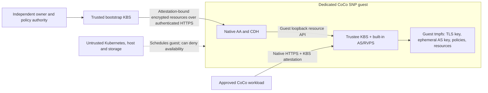

# Trustee in a CoCo SNP guest

For a self-sufficient deployment with attested TLS and owner JWT provisioning,
use [`TngTrustee`](TNG.md). That tested prototype needs no external bootstrap
Trustee. The `Trustee` variant documented below uses a bootstrap KBS.

`Trustee` composes an upstream KBS with its built-in Attestation Service (AS)
and Reference Value Provider Service (RVPS) inside **one dedicated CoCo Pod
VM**. It renders a Deployment, ClusterIP Service, ingress NetworkPolicy and,
by default, Namespace. It uses Nebula's measured-artifact checks and native
CoCo Init-Data, AA, CDH and KBS protocols. There is no Trustee fork, custom
attestation protocol, controller, secret-injection service or cloud KMS.

This is a Nebula integration of upstream primitives, **not an upstream turnkey
confidential Trustee product or a production-qualified deployment**. Official
CoCo documentation still describes support for deploying Trustee inside CoCo
as under development. Deployment requires the independently trusted bootstrap
KBS and qualified guest policy described below.

## What the research establishes

Reviewed 14 October 2026, including the official documentation, operator blog,
and Trustee source at
[`71251310045d8be2e95041cf0028691623c73957`](https://github.com/confidential-containers/trustee/tree/71251310045d8be2e95041cf0028691623c73957).
The configuration and LocalFs layout in this module target that revision.
Its chart advertises 0.21.0, but a 0.21.0 image built earlier does not necessarily
contain that revision's configuration/storage changes. Supply a digest whose
provenance and features have been verified; the module has no default image.

| Finding | Design consequence |
| --- | --- |
| Trustee is the release authority and assumes a trusted hosting environment. | Putting a client in a TEE does not protect the broker's own storage. [Installation](https://confidentialcontainers.org/docs/attestation/installation/) |
| The official Helm chart splits KBS, gRPC AS and RVPS into separate workloads. Its bootstrap uses Kubernetes Secrets. | Merely changing `runtimeClassName` does not protect the entire chain. Use upstream built-in AS/RVPS in the same guest here. [Helm chart](https://github.com/confidential-containers/trustee/blob/71251310045d8be2e95041cf0028691623c73957/deployment/helm-chart/README.md) |
| The operator blog demonstrates orchestration, policies and reference values, including development examples and Secret-based provisioning. | Its sample configuration is not a solution for distrusting cluster administrators. [Operator blog](https://confidentialcontainers.org/blog/2026/08/19/deploy-trustee-in-kubernetes/) |
| The host can still send Kata agent requests to a confidential guest. | Enforce a reviewed guest policy inside the VM and bind it to hardware evidence through Init-Data. [Policing a Sandbox](https://confidentialcontainers.org/blog/2024/08/15/policing-a-sandbox/), [Init-Data](https://confidentialcontainers.org/docs/features/initdata/) |
| CDH exposes resource retrieval to the container on guest loopback and performs the KBS attestation flow. | Use that native interface to bootstrap Trustee. No plaintext Kubernetes Secret is necessary. [Get Secret Resources](https://confidentialcontainers.org/docs/features/get-resource/) |
| The native client adds configured certificates to its HTTP client's roots. That is not exclusive certificate pinning. | Qualify the guest's AA/CDH trust store to accept only the owner's bootstrap authority. [Native client builder](https://github.com/confidential-containers/guest-components/blob/main/attestation-agent/kbs_protocol/src/builder.rs) |
| AS appraisal and KBS resource authorization are separate policies. | Require both strict SNP appraisal and exact resource/recipient authorization. [Policies](https://confidentialcontainers.org/docs/attestation/policies/) |

The upstream [KBS configuration](https://github.com/confidential-containers/trustee/blob/71251310045d8be2e95041cf0028691623c73957/kbs/docs/config.md)
provides built-in AS, HTTPS, `DenyAll` administrative authorization and explicit
token-verification trust anchors. Its
[LocalFs implementation](https://github.com/confidential-containers/trustee/blob/71251310045d8be2e95041cf0028691623c73957/deps/key-value-storage/src/local_fs/mod.rs)
stores resource bytes directly: storage must be protected independently of
the resource API. This module restricts LocalFs to guest tmpfs.

## Boundary and native bootstrap



The root bootstrap KBS must be controlled independently of the infrastructure
administrators being excluded. Its owner approves **both** the complete SNP
launch measurement and final Init-Data hash of this Trustee. That launch
measurement must cover approved firmware, kernel, command line and verified
root filesystem, with guest debug interfaces disabled. HOST_DATA alone is a
host-chosen value, not proof of the software running in the VM.
Each approved identity also names the signed `chip_id` of an independently
reviewed platform, so a different machine with the same software and TCB is not
automatically admitted. Platform approval is still required: chip identity is
not evidence that an unmeasured BIOS mitigation is installed or remains enabled.

The native startup sequence is:

1. Kata validates Init-Data and enforces the approved agent policy. AA/CDH use
   its measured bootstrap HTTPS endpoint and public certificate. Only the
   `resource` REST interface is enabled, on guest loopback; no evidence/token
   export interface is enabled by this module. AA explicitly selects
   `ECDH-ES+A256KW-P256` for its resource-encryption key. AA/CDH logging is
   configured off; the approved guest must also suppress agent/debug/serial
   paths that could export secret material.
2. The measured startup command checks that `/run/trustee` and `/tmp` are tmpfs.
   It fetches the endpoint key/certificate and each declared resource through
   `http://127.0.0.1:8006/cdh/resource/<repository>/<type>/<tag>`. CDH attests to
   the root KBS and decrypts the responses inside the guest. No host-side
   environment credentials, Secret mounts, curl configuration or proxy is used.
3. The command verifies the TLS pair and hostname, generates a fresh local AS
   signing key/certificate, writes the measured public KBS/AS policies, and
   starts KBS only after every fetch succeeds. KBS trusts only that local AS
   certificate. Arbitrary token-header JWKs are disabled.
4. KBS terminates TLS itself and serves only declared resources to their exact
   approved SNP measurement/Init-Data pairs. Debug, migration, missing claims,
   nonnumeric or insufficient reported-TCB components, non-affirming EAR
   status, extra devices and unapproved resource paths are denied.

Do not terminate Trustee TLS on an untrusted ingress. Use the ClusterIP
directly, an L4 pass-through, or a separately approved in-guest transport.
Workload clients must authenticate the Trustee endpoint with an independently
approved public certificate/CA in their own measured AA/CDH configuration.
The served TLS chain must begin with a server leaf certificate, with a matching
DNS SAN and server-auth purpose; do not serve a `CA:TRUE` certificate as the leaf.
Native rustls clients reject it even when an OpenSSL/curl smoke test accepts it.
The bootstrap command rejects this certificate mistake before starting KBS.

**Exclusive server authentication is a guest-image prerequisite.** Upstream
`add_kbs_cert` uses `add_root_certificate`; the native configuration does not
turn off the HTTP library's other trust roots. The approved guest image must
restrict the effective AA/CDH trust store to the owner authority, accounting for
its actual TLS backend/build features and any compiled-in roots. Test that a
different otherwise-trusted certificate for the same hostname is rejected.
Apply this requirement to both Trustee's bootstrap client and workload clients.
DNS, a Kubernetes CA, or a public certificate controlled by the excluded
administrator must not substitute for owner custody. This module binds the
certificate configuration; it cannot change or certify the guest trust store.

## Compose and prepare

Import from `nebula-cdk8s` like the other modules:

```ts
import { Trustee, trusteePlan, trusteeInitData } from "nebula-cdk8s";

// config: TrusteeConfig, containing public configuration and resource paths.
const plan = trusteePlan(config);
// Feed plan.workload (the Deployment) to your pinned Kata genpolicy pipeline.
// Preserve plan.canonicalPodSha256 with the generation inputs.
const policy = trusteeInitData(config, {
  canonicalPodSha256: approvedGeneration.canonicalPodSha256,
  policyRego: reviewedAgentPolicy,
});
new Trustee(chart, "trustee", { ...config, policy });
```

The configuration requires:

| Field | Meaning |
| --- | --- |
| `name`, `namespace` | Dedicated deployment identity; default/system namespaces are refused. |
| `image` | Digest-pinned built-in-AS KBS image with `/usr/local/bin/kbs`, `/bin/sh`, curl, OpenSSL and GNU coreutils. Public image access avoids a circular encrypted-image bootstrap. |
| `bootstrap.url`, `bootstrap.certificatePem` | Independent HTTPS origin and one public X.509 trust anchor. Both are measured. |
| `bootstrap.tlsPrivateKey`, `bootstrap.tlsCertificate` | Distinct three-segment resource paths on that KBS. Use immutable versioned names. Values stay outside deployment configuration. |
| `resources` | Each `path` served by this Trustee, its `bootstrapPath`, and its `recipients`. No raw secret value field exists. |
| `recipients[]` | Exact `measurement` (96 lowercase hex), `initDataSha256` (64 hex), approved `chipId` (128 hex), and four explicit `minimumReportedTcb` byte floors: `bootloader`, `tee`, `snp`, `microcode`. Set floors from platform advisories and owner policy, not sample zeroes. |
| `nodeSelector` | Nonempty selector for an existing qualified SNP worker. This is scheduling, not attestation. |
| `clients` | Namespace plus nonempty Pod-label selector for each network client group. Cryptographic authorization still comes from the KBS policies. |
| Optional fields | `port` (8443), `endpointHost` (Service FQDN), `createNamespace` (true), `guestMemoryMiB` (2048), `guestVcpus` (2). |

The fixed runtime is `kata-qemu-snp`. There is deliberately no nonconfidential
fallback, raw Pod override, external AS, admin-token input, PVC option, extra
sidecar or plaintext-secret option. TDX requires its own verified appraisal
and launch contract before adding support.
The CPU/memory fields set Kata's base annotations and container limits;
runtime resource accounting determines the effective VM size. Reproduce the
launch from the actual approved boot configuration, including the effective
CPU count. In the tested cluster, base 2 plus the container CPU limit produced
4 vCPUs; hashing a 2-vCPU launch correctly failed admission.

The included offline tooling takes public JSON configuration:

```sh
cd packages/nebula
node --import tsx scripts/prepare-trustee.ts template public-config.json prepared

# Generate and review a policy for prepared/deployment.json with your pinned
# genpolicy version, its reviewed settings, and the exact pinned image layers.
# Save the final hardened Rego as reviewed-agent.rego.

node --import tsx scripts/prepare-trustee.ts bind public-config.json \
  prepared/preparation.json reviewed-agent.rego reviewed-artifact.json

node --import tsx scripts/prepare-trustee.ts bootstrap-policies public-config.json \
  reviewed-artifact.json approved-snp-launch.json prepared/bootstrap

node --import tsx example/trustee.ts public-config.json reviewed-artifact.json dist/trustee
```

`approved-snp-launch.json` contains this Trustee VM's owner-approved `measurement`,
`chipId` and `minimumReportedTcb`, not the client workloads' identities. The final
Init-Data hash comes from the reviewed artifact. The generated bootstrap
policies are for owner review and installation on the root KBS; they are not
automatically applied. Do not overwrite a shared root's existing policy without
deliberately composing its other resource bindings.

Provision the root's TLS identity and resource versions through its authenticated
native `kbs-client config ... set-resource` interface from an independently
trusted owner environment. Do not copy them into Kubernetes Secrets. Install
the reviewed root policies using native resource-policy/attestation-policy
operations, and only then reconcile the rendered manifests. The final Trustee
has `DenyAll` admin access: updates use a new reviewed release and bootstrap
resource versions, not in-place upload privileges.

### Guest policy qualification is mandatory

Use `plan.workload`, not a standalone fixed-name Pod, as generator input so
Kata's generated Deployment name rules match real Pods. Approve the exact
container image/layers, argv (including all bootstrap fragments), complete
environment, nonroot identity, guest-pull storage, tmpfs transports, mounts and
pause container. Reject extra containers and devices. Restrict network-update
requests so the host cannot expose the loopback CDH API. The guest must enforce
image integrity and an immutable verified root filesystem.

Remove generated allow clauses for `TRUSTEE_DENIED_AGENT_REQUESTS` and retain
only their `default ... := false` rules. They cover exec, stream read/write,
policy replacement, diagnostics, tracing, both swap APIs, ephemeral-mount
updates and the agent's policy-bypass switch. CopyFile
must default-deny; the optional exported `TRUSTEE_STARTUP_METADATA_POLICY` is
the only accepted exception, for bounded runtime metadata before creation.
Its `pstate` assumptions must match the pinned generator and agent. Do not
allow a general shared-directory prefix. Prevent debug console/serial output
in the approved VM image and boot arguments as well.
The `pstate.trustee` latch must be set when the workload is created and survive
container removal; reserve that state key and deny attempts to remove it.
Use the same persistent latch to close network configuration after startup.
A policy with this irreversible latch can require a replacement Pod after a
container exit, including a bootstrap failure. Recover by recreating the Pod
after correcting the cause, preserving the same approved release.

The module checks the sensitive RPC source shape, exact public bootstrap
configuration, bounded gzip envelope and template/hash correspondence. It
**does not prove the semantics of arbitrary owner-supplied Rego**, compile a
complete genpolicy policy, or attest hardware during synthesis. In particular,
the measured template hash is an approval/change-detection binding; guest
policy must still enforce the corresponding commands and image. Never approve
an Init-Data hash on the root solely because these synthesis checks passed.

## Operational limits

- Infrastructure/cluster/host administrators cannot obtain plaintext through
  this module's storage or provisioning interfaces under the qualified TEE and
  policy assumptions. A root administrator *inside* the approved guest, a
  compromised authorized workload, or an owner able to approve arbitrary code
  or change root release policy remains trusted. Excluding every administrator
  is not a property Trustee can supply; split policy/custody authority if needed.
- Repository state is ephemeral. Startup reloads the complete release through
  CDH; a new VM performs fresh attestation. A sealed guest policy can require
  Pod replacement rather than an in-place container restart. No backup, durable
  storage, extra host or paid service is created. The bootstrap KBS owns durable
  resources and recovery and must be available at boot. No insecure fallback is
  provided. Pod memory/CPU requests still consume existing cluster capacity.
- Pin immutable bootstrap resource versions. Changes to their contents under
  the same URI cannot be detected by a manifest hash. The independent owner
  must enforce version immutability and retirement.
- Encryption/attestation do not prevent host denial of service, clones of an
  approved release, replay of old approved releases, or use of keys already
  cached in a paused/running guest. Root-policy revocation gates future release;
  this module does not provide immediate revocation, continuous freshness,
  singleton enforcement or rollback-resistant persistence.
- Old keys exposed on host storage must be rotated separately. Rehosting them
  does not restore confidentiality. Image publishers handling plaintext image
  keys also remain inside the custody boundary unless independently protected.
- Startup errors are generic; KBS stdout/stderr are discarded and exec/stream
  APIs are denied. TCP readiness indicates a listening process, not successful
  hardware attestation or a security certification. Diagnose with synthetic
  releases and independently held validation evidence.

## Validation

### Development SNP qualification, 14 October 2026

The module ran on the existing development SEV-SNP baremetal worker with the
native guest AA/CDH and upstream KBS image. The
[sanitized qualification record](../../../../test/evidence/trustee-snp-dev-2026-10-14.json)
records the image, generator, boot hashes, Init-Data hashes and limits.
All material was synthetic. A temporary ordinary Pod simulated the independently
trusted bootstrap authority; this did **not** establish production custody.

| Live check | Result |
| --- | --- |
| SNP Trustee bootstrap | Native attestation succeeded; all three encrypted bootstrap resources were retrieved. |
| Separate CoCo client | Native retrieval succeeded; the synthetic resource's SHA-256 matched. |
| Wrong launch or unapproved Init-Data | Resource release denied. The Init-Data test used the approved launch. |
| Host changes command while retaining approved Init-Data | Guest denied `CreateContainerRequest`. |
| Cluster-admin exec | Guest denied `ExecProcessRequest`. |
| Unauthenticated resource read / resource write / policy write | HTTP 401. |
| Trustee's host-side volume tree / container output | No files in the volume tree; no log bytes. This is not a physical-memory audit. |
| Raise required SNP SVN from 24 to 27 | Native attestation completed, bootstrap resource returned 403, KBS never became ready. |

The fresh report had bootloader 10, TEE 0, SNP 24, microcode 88 and zero launch/
current mitigation vectors. The inspected ASUS K14PA-U12 board reported custom
BIOS `2202-HET0009-25082201` dated 22 August 2025. **This platform is not approved
for production secrets or a hostile-host security claim.**
[AMD SB-3023](https://www.amd.com/en/resources/product-security/bulletin/amd-sb-3023.html)
lists Genoa mitigations with SNP SPL `0x1B` (27) and additional platform/OS
requirements. [AMD SB-3030](https://www.amd.com/en/resources/product-security/bulletin/amd-sb-3030.html)
also requires OEM firmware review; its September revision removed TCB/mitigation
bit mappings, so those fields alone cannot establish remediation.
[ASUS's release notes](https://www.asus.com/us/supportonly/k14pa-u12/helpdesk_bios/)
list newer BIOS 2403 with Genoa AGESA 1.0.0.H. The provider must confirm the
compatible update for its customized BIOS before maintenance/requalification.

The tested upstream SNP verifier does not expose mitigation vectors in its
appraisal claims. The explicit chip ID and TCB floors in this module do not
close that gap. Production still requires independently governed bootstrap
custody, approved platform mitigations, owner-only effective AA/CDH TLS trust,
verified image provenance, and the full guest-policy adversarial qualification.

### Automated checks

```sh
node --import tsx --test test/trustee.test.ts
pnpm verify:broker-admission
pnpm exec tsc --noEmit

# Optional local Docker test: use a qualified built-in-AS image by digest.
TRUSTEE_TEST_IMAGE="$KBS_IMAGE_DIGEST" node --import tsx --test test/trustee-runtime.integration.test.ts
```

The policy tier evaluates generated Trustee policies with Regorus 0.10.1 and
EAR 0.5.0, including cross-resource isolation, mixed release pairs, debug and
migration, malformed claims and TCB downgrades. Synthetic deny-only policies
in the unit tests are not deployable policies.

The opt-in Docker test uses a synthetic loopback CDH and synthetic credentials,
with no external network, to exercise the actual upstream KBS configuration,
TLS, administrative denial, token endorsement, encrypted resource retrieval,
resource policy, missing/mismatched credentials and refusal of non-tmpfs state.
It signs synthetic claims using the test container's issuer, so it does not test
the attestation handshake, real CDH or hardware isolation. Pull the pinned KBS
and test Python images before an offline run. It never needs production keys.

Before production, qualify the actual image/runtime on SNP hardware: accepted
bootstrap and client attestation; wrong launch/Init-Data denial; exec/copy/
sidecar/mount/image/environment tampering; host inspection showing no plaintext;
native HTTPS identity and admin denial; bootstrap outage; restart/recovery; and
the documented revocation/clone limits. A successful local render or software
policy test is not evidence that those hardware tests passed.
