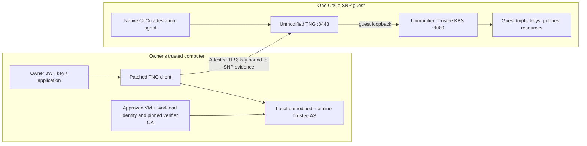

# Self-sufficient Trustee with TNG

`TngTrustee` runs unmodified upstream Trustee KBS (built-in AS/RVPS) and
unmodified upstream TNG in one CoCo SEV-SNP guest. It generates its own keys
inside the guest and starts with deny-all release policies. The owner first
verifies the attested connection, then provisions resources through Trustee's
native JWT administration API. **No bootstrap Trustee or Kubernetes Secret is
required.** This is an ephemeral development prototype, tested on the existing
dev baremetal SNP worker on 15 October 2026.



The local verifier is part of the client's trust boundary. It supplies no
bootstrap secrets and is not another hosted Trustee dependency. An untrusted
remote verifier, or accepting whatever verifier key the server supplies, would
break this design. Network policy reduces exposure; attestation, TLS, guest
policy and owner authorization provide the security boundary.

## Closing workload verification

TNG v2.11.0 supports native CoCo `coco_asr` evidence collection. Its bundled AS
uses the OpenAnolis Trustee revision
[`94e2f4b`](https://github.com/openanolis/trustee/tree/94e2f4bc172e0fe78f377085361a042f687a0c63).
That SNP verifier does not expose HOST_DATA for this workload check. This
prototype instead calls a client-local mainline AS. The reviewed
[mainline SNP verifier](https://github.com/confidential-containers/trustee/blob/71251310045d8be2e95041cf0028691623c73957/deps/verifier/src/snp/mod.rs)
verifies the report and exposes signed HOST_DATA as `init_data`.

`tngTrusteeClientPlan` requires one explicit approved tuple: launch measurement,
InitData SHA-256, chip identity and reported-TCB floors. It rejects debug and
migration-enabled reports. TNG verifies the local AS token's signature and CA,
requires an affirming appraisal, and binds the evidence to the TLS public key.
The exact approved InitData contains the enforced guest policy, owner public
key, image digests, command arguments and public startup configuration.

This only establishes workload integrity when the approved guest enforces
InitData and verifies the pinned container images. An arbitrary hash in
HOST_DATA is insufficient. Approve the expected launch measurement from the
reviewed launch inputs; do not learn the expected identity from the connection
being authenticated. The live test independently calculated the launch
measurement and matched it against the cryptographically verified report.

The included [client patch](patches/tng-2.11-mainline-trustee.patch) applies to
[TNG v2.11.0 / `9259341`](https://github.com/inclavare-containers/TNG/tree/9259341240503dc645d7ad40b3a595240134cceb):

1. An explicitly pinned verifier CA avoids the OpenAnolis-only `/certificate`
   discovery endpoint, which mainline AS does not provide.
2. JWT `x5c` certificates use standard Base64 as required by RFC 7517; legacy
   base64url remains accepted. Certificate and token verification stay enabled.

Only the **client** is patched. Do not enable `skip_as_token_cert_verify` or use
a hardware-only appraisal to make an incompatible client connect.

## Compose and prepare

Run these commands from `packages/nebula` in a checkout. Preparation helpers and
examples live in the repository; the published package exports the construct
and planning functions, with the patch under `src/`.

Create an owner P-256 key in the owner's trusted environment:

```sh
umask 077
openssl ecparam -name prime256v1 -genkey -noout -out owner.key
openssl pkey -in owner.key -pubout -out owner.pub
```

Keep `owner.key` out of manifests, Git and cluster storage. Public configuration
has the following `TngTrusteeConfig` fields:

| Field | Required value |
| --- | --- |
| `name`, `namespace` | Deployment name and dedicated namespace |
| `kbsImage`, `tngImage` | Public images pinned by SHA-256 digest |
| `ownerPublicKeyPem` | Contents of `owner.pub`, never the private key |
| `nodeSelector` | Exact selectors for the approved SNP worker |
| `clients` | Allowed namespace / `podLabels` pairs for the network policy |
| `createNamespace` | Optional; defaults to true |

```ts
import { TngTrustee, tngTrusteePlan, tngTrusteeInitData } from "nebula-cdk8s";

const plan = tngTrusteePlan(config);
// Generate and review the policy for this exact plan.workload.
const policy = tngTrusteeInitData(config, {
  canonicalPodSha256: plan.canonicalPodSha256,
  policyRego: reviewedPolicy,
});
new TngTrustee(chart, "trustee", { ...config, policy });
```

Equivalent offline preparation and synthesis:

```sh
node --import tsx scripts/prepare-tng-trustee.ts template public-config.json prepared
# Run the approved Kata genpolicy pipeline on prepared/deployment.json, then review/harden it.
node --import tsx scripts/prepare-tng-trustee.ts bind public-config.json prepared/preparation.json reviewed.rego artifact.json
node --import tsx example/tng-trustee.ts public-config.json artifact.json dist/tng-trustee
```

The module's conservative source gate is not a semantic Rego audit. The
qualified development hardener is
[`test/support/tng-trustee-dev-policy.mts`](../../../../test/support/tng-trustee-dev-policy.mts).
It requires a prepared directory containing `config.json`, `generated.yaml`,
`rules.rego`, `settings.json`, and an owner-reviewed `network.json` with anchored
`ipv4AddressPattern` / `ipv6AddressPattern` expressions for the worker's pod
ranges. It pins the reviewed generator rules/settings by hash, checks the exact
image/argv/user/storage shape, requires measured environment values, and
outputs `trustee.rego`, `artifact.json`, and `manifest.json`.

Generate from the Deployment with Kata genpolicy `-y generated.yaml -p
rules.rego -j settings.json -u`. The qualified generator does not parse
`automountServiceAccountToken`, `enableServiceLinks`, `runAsNonRoot`, or
`seccompProfile`; omit those only in the generator's input copy. Keep them in
the deployed plan. The qualification record pins the generator binary and its
rules/settings. Supply those reviewed inputs independently; the helper refuses
different hashes.

The policy admits the two declared workloads once, freezes network changes
after workload creation, permits bounded startup metadata copies only before
sealing, and blocks host exec, stream read/write, guest-policy replacement,
swap and diagnostics. Its persistent latches survive container removal, so a
container restart requires a new Pod VM. Test policy changes on the actual
guest engine before approving a new InitData hash.

## Verify and provision

The owner client is the sibling Node package
[`@nebula/trustee-client`](../../../../../trustee-client/README.md), with an
importable API and a `nebula-trustee` command. It manages the local unmodified
AS and patched TNG, checks an authenticated round trip, and shuts both down
when the operation finishes. No external bootstrap service is required.

Build/install the package and native TNG as described in its README. Then:

```sh
nebula-trustee prepare --identity expected-snp.json --host trustee.example.test \
  --port 8443 --state /path/to/new/client-state
nebula-trustee verify --state /path/to/new/client-state \
  --tng /path/to/tng-source/target/release/tng --owner-key owner.key --audience trustee
nebula-trustee put-resource owner/image-key/release-1 resource.bin \
  --state /path/to/new/client-state --tng /path/to/tng-source/target/release/tng \
  --owner-key owner.key --audience trustee
```

`expected-snp.json` uses `TrusteeSnpIdentity`: `measurement` (96 hex digits),
`initDataSha256` (64), `chipId` (128), and `minimumReportedTcb` with all four
numeric components. Preparation creates a private local signer, a pinned CA,
`approved_cpu.rego`, `as.json`, `tng.json`, and a versioned `client.json` profile.
It removes the CA private key and refuses to overwrite an existing directory.
TNG expects `clientAuth` usage on the AS token-signing certificate. On connection,
the package checks that policy and configuration still match the approved profile.

The owner token has issuer `nebula-owner`, audience equal to `config.name`, role
`owner` and a five-minute lifetime. Normal client calls generate tokens in memory;
they never place the token or resource bytes in subprocess arguments or logs.
The owner key is never mounted into the local AS container. Both local listeners
bind to loopback, and remote Docker daemons are rejected. The owner's machine,
local Docker runtime, native TNG executable and approved identity inputs are
trusted parts of the client boundary.

Use `set-resource-policy` and `set-attestation-policy` to install reviewed Rego,
or use the same methods on `TrusteeClient` from Node. `trusteePolicies` is exported
by both packages from the same source. Both attestation appraisal and resource
policy must approve the recipient. The owner is intentionally authorized to
change these policies; an excluded infrastructure administrator must not possess
the owner key. Resource retrieval by a confidential workload continues to use
CoCo's native KBS/CDH protocol; an owner JWT does not replace recipient attestation.

For offline verification, pass `--vcek public-vcek.der` to `prepare`. This uses
mainline AS's native `OfflineStore`; AS still validates the AMD certificate chain
and signed report. The cache is public endorsement material, not a bootstrap
secret. Reprepare a new state directory when the approved identity or certificate
chain changes; do not edit the generated policy or disable certificate checks.

Route the TLS connection through L4 pass-through to the CoCo Pod. Do not
terminate it in an infrastructure-controlled ingress. On this dev runtime,
`kubectl port-forward` reached host-side sandbox loopback instead of guest
loopback; an SSH tunnel to the Pod IP carried the real TNG connection. SSH was
only transport: the client still independently verified SNP evidence and TLS
key binding.

## Qualified result and limits

The [sanitized test record](../../../../test/evidence/tng-trustee-snp-dev-2026-10-15.json)
contains exact image, source, policy and measurement pins and positive/negative
results. The approved guest served owner-authorized administration requests;
native KBS attestation returned an affirming token, and an encrypted resource
was retrieved and its digest checked. The recipient private key in that test
stayed on the owner's computer; a measured SNP probe emitted only evidence for
the fixed key and challenge. This does not claim a CDH client decrypted the
resource inside a second TEE.

Wrong workload/VM/chip identities, modified report signatures, evidence copied
onto another TLS key, missing evidence and an unrelated verifier CA were
rejected. Host exec and changed workload commands were blocked. The host could
reach port 8443 but not guest loopback ports 8006/8080; its Pod volume directory
contained no files. No Kubernetes Secrets were used. These are bounded tests,
not proof against every attack.

State is guest-memory-only. Restarting or replacing the VM loses resources and
keys; the owner must attest and provision again. Certificates currently have
short prototype lifetimes, with no durable identity or renewal orchestration.
One approved measurement/owner key can authorize multiple identical instances:
JWT authenticates the owner, and attested TLS authenticates possession of the
guest key. They do not implement singleton identity, anti-rollback, or
continuous/challenge-fresh re-attestation. TNG's prototype evidence refresh is
disabled (`refresh_interval: 0`). Infrastructure can still deny availability.
The digest-pinned upstream images were exercised as supplied; independent
source-to-image provenance and a production security audit remain outstanding.
